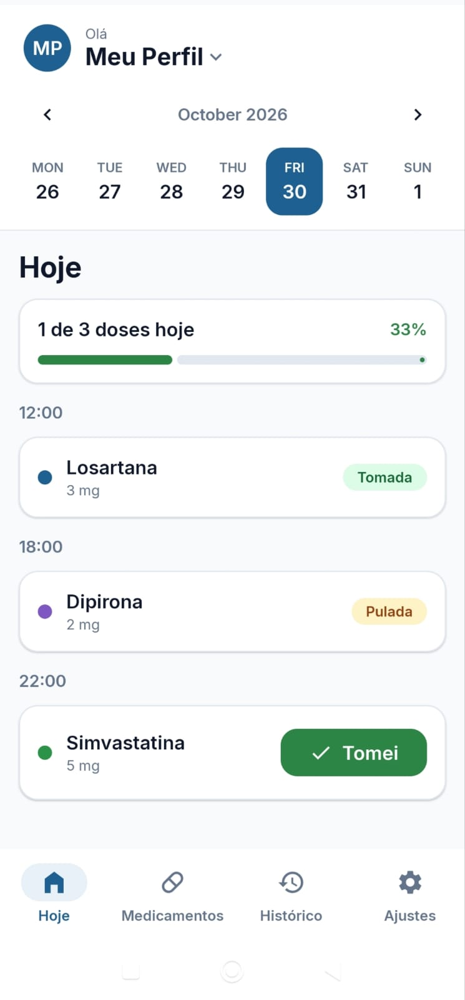
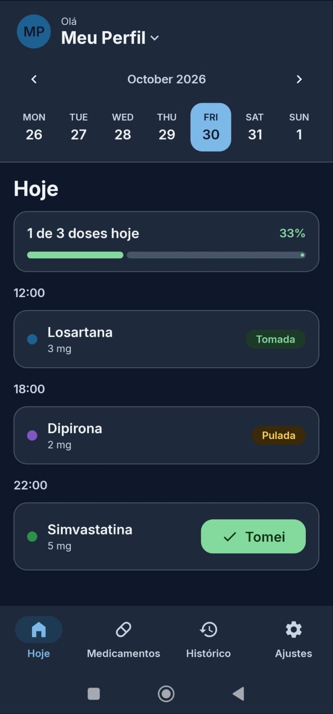
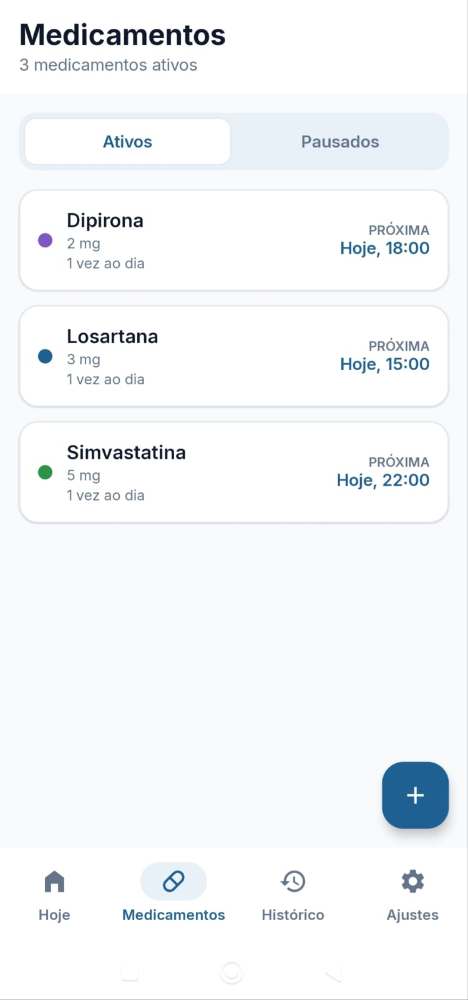
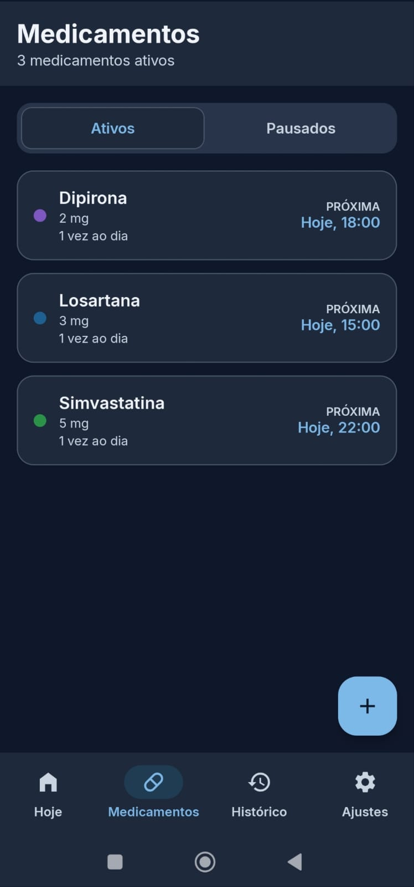
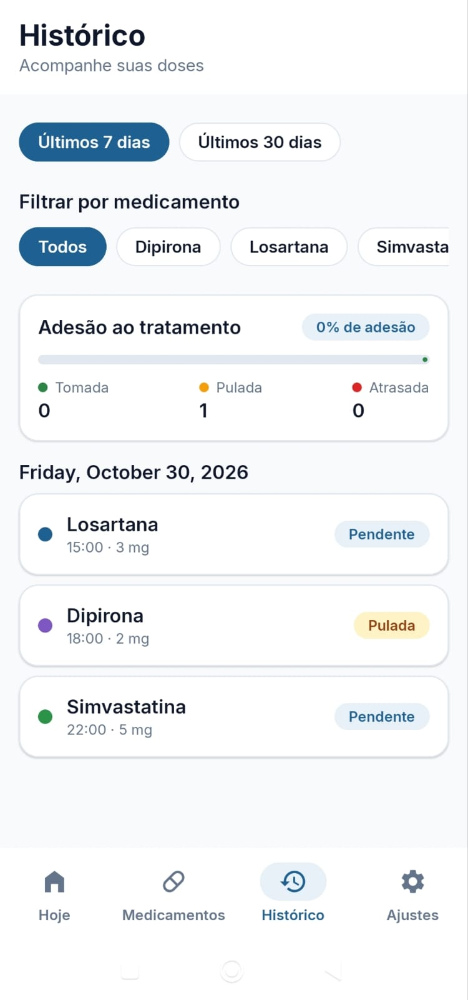
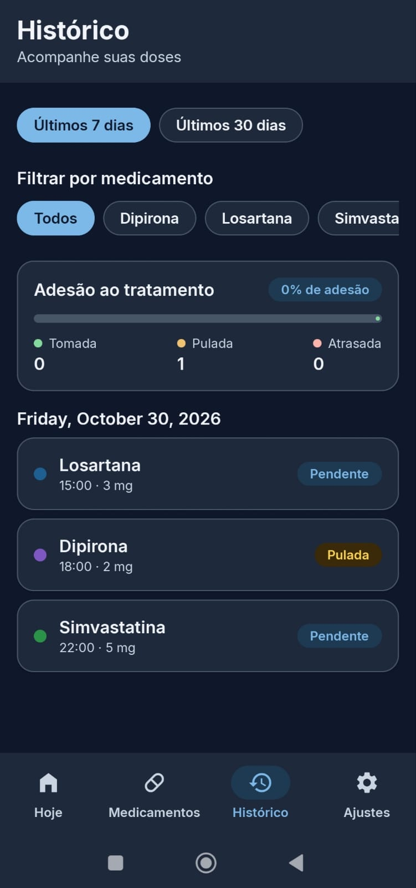
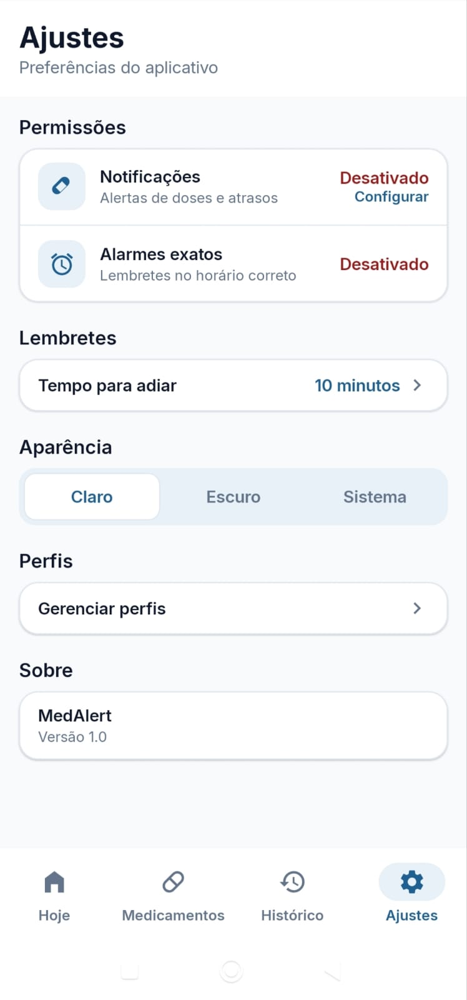
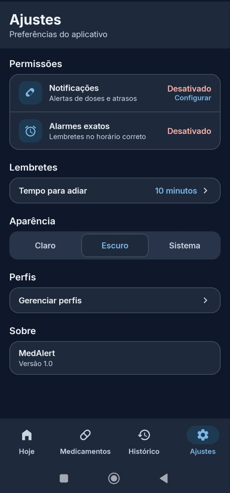

<h1 align="center">MedAlert</h1>

<p align="center">
  
  
  
  
  
  
  

</p>

Aplicativo Android de lembretes de medicação, feito como projeto de estudo e portfólio, com foco em **arquitetura limpa, testes e acessibilidade**.

> *English summary: MedAlert is an Android medication reminder app built with Kotlin, Jetpack Compose (Material 3), Hilt, Room and DataStore, following MVVM and Clean Architecture with a package-by-feature layout. It schedules exact-alarm reminders, supports multiple profiles, tracks adherence history, and ships with light/dark themes and a UI matched to a Figma design.*

---

## 📌 Sobre o projeto

O MedAlert ajuda a manter a rotina de medicamentos em dia. O usuário cadastra seus medicamentos com dose e frequência, recebe notificações nos horários certos e registra se tomou, pulou ou adiou cada dose, direto da notificação ou dentro do app. Todos os dados ficam **somente no aparelho** (sem conta, sem servidor).

O app suporta **múltiplos perfis**, por exemplo para cuidar dos medicamentos de familiares, cada um com seus próprios medicamentos e histórico.

> ⚠️ **Aviso:** o MedAlert é um projeto de estudo e não substitui orientação médica. Não é um dispositivo médico.

---

## Telas

| Tema claro | Tema escuro |
|---|---|
|  |  |
|  |  |
|  |  |
|  |  |

---

## Funcionalidades

- **Hoje:** doses do dia por horário, faixa semanal e progresso. Cada dose aparece como Pendente, Tomada, Pulada ou Atrasada, e é possível marcar ou desfazer (doses futuras não podem ser marcadas).
- **Medicamentos:** cadastro e edição com nome, forma, dosagem, frequência, horários, período do tratamento, cor e observações. Também é possível **pausar, retomar e excluir**, preservando o histórico.
  - Frequência: todos os dias (vários horários), dias específicos da semana ou a cada X horas (1, 2, 3, 4, 6, 8, 12 ou 24).
- **Lembretes:** notificações com alarme exato (`AlarmManager`) e ações *Tomei*, *Pular* e *Adiar* (5, 10, 15 ou 30 minutos). Sem a permissão de alarme exato, o app usa alarme inexato como alternativa.
- **Reagendamento automático** dos lembretes após reiniciar o aparelho, mudar fuso/horário ou atualizar o app.
- **Perfis:** vários perfis com nome e cor, o último perfil não pode ser excluído.
- **Histórico:** últimos 7 ou 30 dias, filtro por medicamento e taxa de adesão.
- **Ajustes:** tema claro, escuro ou do sistema, tempo de adiamento e permissões de notificação e alarmes exatos.
- **Onboarding:** apresentação inicial com pedido de permissões.

---

## Arquitetura

**MVVM com Clean Architecture**, organizada por funcionalidade (*package by feature*). Cada feature separa `presentation`, `domain` e `data`, e a regra de dependência aponta sempre para o domínio, que não depende de Android.

```
UI (Compose) ──► ViewModel ──► UseCase ──► Repository (interface, no domain)
                                  │                  ▲
                         regras de negócio    RepositoryImpl ──► Room / DataStore
                          (domain/rules)
```

```
app/src/main/java/com/davialmeida/medalert/
├── core/          # base compartilhada: resultado/erros, DI, relógio, banco
├── compose/       # tema (cores, tipografia, formas) e componentes reutilizáveis
├── common/        # utilitários de data
├── today/         # tela Hoje: doses do dia, registro e status
├── medication/    # cadastro, lista, detalhe, pausar/retomar, versões
├── history/       # histórico e adesão
├── profile/       # perfis
├── reminder/      # alarmes, notificações e permissões
├── settings/      # ajustes e preferências
└── onboarding/    # primeira abertura
```

Cada funcionalidade segue as camadas `presentation → domain ← data`:

- **domain:** modelos, casos de uso, regras, validadores e interfaces de repositório, sem dependência de Android.
- **data:** Room, DataStore e implementações dos repositórios.
- **presentation:** ViewModels com `StateFlow` e telas em Compose.
- **di:** módulos Hilt que ligam as implementações às interfaces.

### Decisões de projeto

- **Resultado tipado:** casos de uso retornam `AppResult<T>` (sucesso ou erro de domínio) em vez de lançar exceções para a UI.
- **Regras puras e testáveis:** cálculo de doses, status e adesão ficam em funções do domínio.
- **Relógio injetável** (`Clock`), o que torna testável o comportamento que depende de data e hora.
- **Versionamento de medicamentos:** ao alterar dose ou frequência de um medicamento já iniciado, a versão antiga é encerrada no dia anterior e uma nova começa hoje. Assim o histórico passado continua fiel ao tratamento da época.
- **Status de dose derivado:** o app só grava *tomada* ou *pulada*; *pendente* e *atrasada* são calculadas pelo horário atual (tolerância de 30 minutos).

---

## Regras de negócio

| Regra | Detalhe |
|---|---|
| Nome do perfil | 3 a 30 caracteres |
| Nome do medicamento | Obrigatório, até 60 caracteres |
| Dose | Maior que zero |
| Horários | Pelo menos um, sem repetição |
| Data de término | Não pode ser anterior à de início |
| Dose atrasada | Não registrada após 30 minutos do horário |
| Adesão (%) | `tomadas ÷ (tomadas + puladas + atrasadas)` |
| Pausar | Só medicamentos ativos que começaram antes de hoje; encerra o tratamento no dia anterior |
| Retomar | Cria uma nova versão começando hoje |
| Excluir | Remove o medicamento **e todo o histórico de doses**; excluir um perfil remove também seus medicamentos |

---

## Design e acessibilidade

- Interface construída a partir de um protótipo no Figma, com tokens de cor, tipografia (Inter) e formas centralizados em `compose/theme`.
- Tema claro e escuro, com cores de status próprias para cada um.
- Contraste de texto verificado para o nível AA (4,5:1) nos dois temas.
- Descrições para leitores de tela (TalkBack) nos ícones, estados de seleção nos chips e dias da semana, e alvos de toque de 48dp.
- Splash screen nativa, sem *flash* de tema na abertura.

---

## Tecnologias

| Área | Uso |
|---|---|
| Linguagem | Kotlin 2.2 |
| Interface | Jetpack Compose, Material 3, Navigation Compose |
| Injeção de dependência | Hilt |
| Persistência | Room (com schemas versionados e migrations) e DataStore |
| Assíncrono | Coroutines e Flow |
| Lembretes | AlarmManager (alarmes exatos), `BroadcastReceiver` e notificações com ações |
| Testes | JUnit, `kotlinx-coroutines-test` e fakes |
| Integração contínua | GitHub Actions |

---

## Como rodar

**Requisitos:** Android Studio recente, JDK 17 e um aparelho ou emulador com Android 8.0 (API 26) ou superior. O app não depende de servidor, chaves de API ou variáveis de ambiente.

```bash
git clone https://github.com/DaviAlme1da/MedAlert.git
```

1. Abra a pasta no Android Studio e aguarde a sincronização do Gradle.
2. Rode o módulo `app` em um emulador ou aparelho.
3. Na primeira abertura, conceda as permissões de **notificação** e de **alarmes exatos** para receber os lembretes. Sem a de alarmes exatos, os lembretes ainda funcionam, mas podem atrasar alguns minutos.

Pela linha de comando: `./gradlew assembleDebug`

---

## Testes

Os testes cobrem casos de uso, regras de domínio, validadores, ViewModels e a camada de dados. Os unitários usam fakes e `kotlinx-coroutines-test`; os instrumentados verificam o banco Room e os repositórios. A integração contínua roda no GitHub Actions.

```bash
./gradlew test                 # testes unitários
./gradlew connectedAndroidTest # testes instrumentados (requer aparelho ou emulador)
```

---

## Próximos passos

Ideias que ficaram fora da primeira versão, para evoluir o projeto:

- Busca e filtro na lista de medicamentos
- Registro de dose tomada em outro horário e campo de observação
- Calendário mensal e período personalizado no histórico
- Compartilhar o relatório de adesão
- Mais cores de medicamento

---


## Autor

<p>
Desenvolvido por <strong>Davi Lucas de Almeida</strong>.<br>
Estudante de Análise e Desenvolvimento de Sistemas (ADS).
</p>
